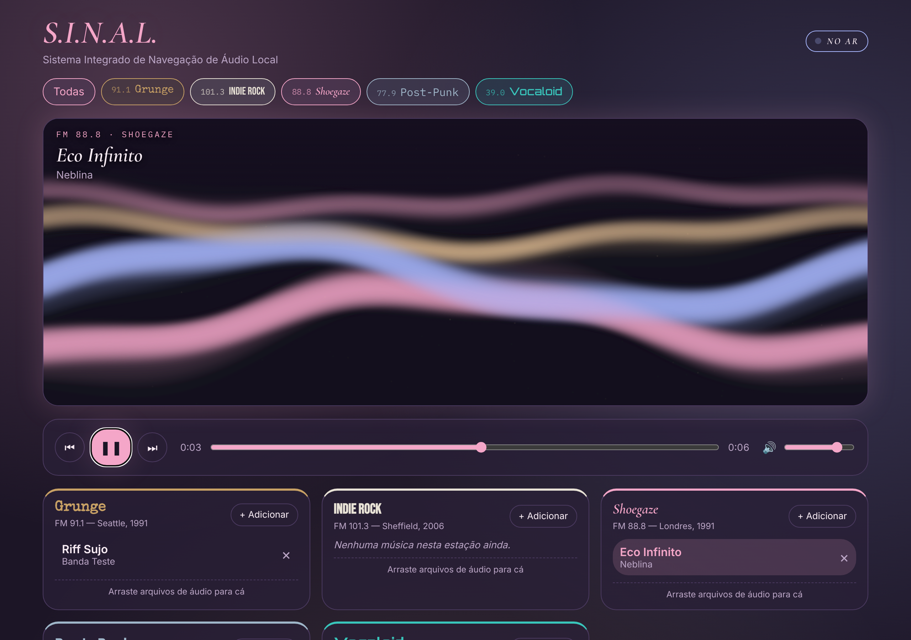

# 📡 S.I.N.A.L.

**Sistema Integrado de Navegação de Áudio Local**: um player de música organizado em *estações*, cada uma com identidade visual própria e um visualizador de áudio em tempo real.

Hoje é uma aplicação web. O plano é virar um **player físico com ESP32**.

**▶ Teste online:** https://itslozhy.github.io/S.I.N.A.L---sistema-integrado-de-navega-o-de-udio-local/



## Funcionalidades
- **Sua biblioteca, salva localmente.** Adicione músicas pelo botão ou arrastando arquivos. Elas ficam guardadas no **IndexedDB** do navegador e continuam lá depois de recarregar a página ou fechar o navegador.
- **5 estações**, cada uma com tema e visualizador próprios:

  | Estação | Visualizador |
  |---|---|
  | Grunge | barras rasgadas, granulado de xerox, glitch nos graves |
  | Indie Rock | palco com holofote pulsando no bumbo |
  | Shoegaze | névoa colorida borrada |
  | Post-Punk | espectrograma "cachoeira" em tela CRT |
  | Vocaloid | anel neon radial com partículas |

- **Dial**: ligue e desligue estações; a fila intercala as músicas entre as estações ligadas.
- Nomes no formato `Artista - Título.mp3` são separados automaticamente em artista e título.
- Lembra as estações ligadas e o volume; mostra o espaço ocupado; histórico e atalhos de teclado.

## Tecnologias
React 19 · TypeScript · Vite · Web Audio API (`AnalyserNode`) · Canvas 2D · IndexedDB

## Arquitetura
```
src/
  stations.ts        registro das estações (nome, frequência, cor, fonte)
  storage/db.ts      biblioteca no IndexedDB (salvar, carregar, remover)
  queue.ts           fila intercalada entre estações
  viz/*.ts           um estilo de visualizador por estação
  components/        Visualizer (canvas) e StationPanel (lista + upload)
  App.tsx            player: <audio> → AudioContext → AnalyserNode
  App.css            temas por estação ([data-station])
```
Para adicionar uma estação nova, inclua o id em `types.ts`, um item em `stations.ts`, um visualizador em `viz/` e um tema no CSS.

## Rodando
```bash
npm install
npm run dev
```

## Deploy
Cada push na `main` dispara o workflow `.github/workflows/deploy.yml`, que roda lint e build e publica a pasta `dist/` no GitHub Pages.

## Roadmap rumo ao hardware (SINAL-32)
O modelo de dados já pensa no aparelho físico: **cada estação corresponde a uma pasta no cartão SD** (`/grunge`, `/indie`, `/shoegaze`, `/postpunk`, `/vocaloid`).

- [x] **v0.1, web**: biblioteca persistente, estações, visualizadores
- [ ] **v0.2**: exportar/importar a biblioteca no formato de pastas do cartão SD
- [ ] **v0.3, protótipo**: ESP32 + leitor microSD + DAC I²S (ex.: MAX98357A) tocando MP3 por estação
- [ ] **v0.4, interface**: encoder rotativo como "dial" de estações + display OLED/TFT com um visualizador simplificado
- [ ] **v0.5**: ponte web ↔ aparelho (Wi-Fi/Bluetooth) para enviar músicas e controlar o player
